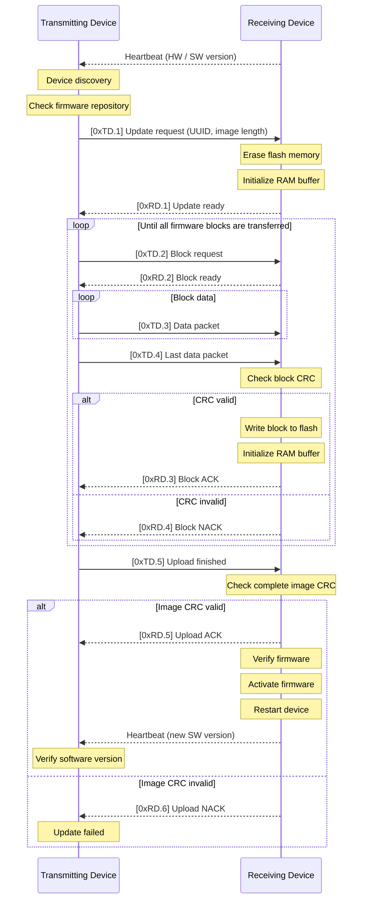

# Software Upload

The software upload mechanism enables the firmware of all devices connected to the CAN bus to be updated to a desired software version. The update process is controlled by a **Transmitting Device**, while the devices to be updated are referred to as **Receiving Devices**.

## 1. Device Discovery and Update Preparation

Initially, the Transmitting Device operates exclusively in passive mode and monitors communication on the CAN bus.

The procedure consists of the following steps:

1. **Registration:** The device responsible for performing the update process registers on the CAN bus as a Transmitting Device.
2. **Device discovery:** The Transmitting Device monitors heartbeat messages to determine which Receiving Devices are active on the bus and identify their hardware and software versions.
3. **Version comparison:** By comparing this information with its own update repository, the Transmitting Device determines which devices have suitable firmware updates available.

Based on this information, the Transmitting Device can initiate the required update processes.

## 2. Basic Communication Principles

The following principles apply when performing a software update:

- Each update process takes place exclusively between a Transmitting Device and a specific Receiving Device.
- The Receiving Device transmits its messages using its assigned **Generic address range**.
- The Transmitting Device also uses the **Generic address range** for its messages. This ensures that each participant can transmit large amounts of data to other participants.
- While an update is in progress, all devices not involved in the update ignore the corresponding update messages.

This ensures that communication can be unambiguously associated with the addressed device.

## 3. Software Upload Procedure

The update process is performed individually for each device to be updated and consists of several phases.

### 3.1 Initialization

**[0xTD.1] – Software Upload Init**

The Transmitting Device initiates the update process and transmits the UUID of the target device along with the total length of the firmware image.

**[0xRD.1] – Readiness Acknowledgment**

The addressed Receiving Device prepares to receive the firmware. The following steps are performed:

- Erase the designated flash memory area.
- Initialize the RAM block buffer with 0xff.
- Prepare for data transfer.

Once the device is ready to receive data, it confirms the request with a positive acknowledgment.

All other devices on the CAN bus ignore subsequent messages associated with this update process.

### 3.2 Firmware Image Transfer

The firmware image is transferred in blocks of **512 bytes**. The following sequence is performed for each block:

1. **[0xTD.2] – Block Request:** The Transmitting Device announces the transfer of a new data block and transmits its block number.
2. **[0xRD.2] – Block Readiness:** The Receiving Device confirms that it is ready to receive the announced block.
3. **[0xTD.3], [0xTD.4] – Data Transfer:** The Transmitting Device transmits the data of the current block.
4. **[0xRD.3], [0xRD.4] – Block Acknowledgment:** The Receiving Device acknowledges receipt of the data block. Once the last data packet [0xTD.4] has been received, the Receiving Device verifies the data against the checksum. If the data has been received without errors, it is stored in flash memory and the RAM buffer is initialized with 0xff. A positive acknowledgment [0xRD.3] is then sent. If verification fails, the block is rejected [0xRD.4].

This sequence is repeated until the entire firmware image has been transferred.

### 3.3 Completion of Data Transfer

**[0xTD.5] – Upload Completion Message**

After all data blocks have been transferred, the Transmitting Device signals the end of the firmware upload.

**[0xRD.5], [0xRD.6] – Result Acknowledgment**

The Receiving Device verifies the integrity of the received firmware image using the CRC checksum and reports the result to the Transmitting Device.

A successful CRC check merely confirms that the data has been transferred correctly. It does not yet confirm successful installation or correct operation of the new firmware.

### 3.4 Firmware Activation and Verification

Following successful data transfer, the Receiving Device performs the required checks on the firmware image.

If these checks are completed successfully, the new firmware is programmed into the designated flash memory area, if necessary, and the device is subsequently restarted.

After restarting, the Receiving Device resumes its normal communication on the CAN bus.

Based on the received heartbeat messages and the software version information they contain, the Transmitting Device can verify whether the device has started with the expected firmware version.

Only then can the entire update process be considered successfully completed.

## 4. Timing and Timeout Monitoring

Communication between the Transmitting Device and the Receiving Device is subject to timeout monitoring on both sides. Each relevant CAN message starts or resets the corresponding monitoring timer.

Expected responses or subsequent messages must arrive within a time window of 1.5 seconds. If this time is exceeded, communication is considered interrupted. There is one exception: The response to TD.1 (erase flash, initialize RAM) may take up to 10 seconds.

**Block Transfer**

A 512-byte data block is transferred without intermediate acknowledgments. Once readiness to receive the block has been confirmed, the Transmitting Device sends all CAN messages belonging to the block in immediate succession. Only after the entire block has been transferred does it wait for an acknowledgment from the Receiving Device.

Since the received data is initially written directly into a RAM buffer, it can be processed quickly without additional delays. This approach reduces communication overhead and enables high data throughput.

**Transmitting Device Timeout Behavior**

If the Transmitting Device does not receive an expected response within the specified timeout period, the ongoing update process is aborted and an appropriate error message is issued.

**Receiving Device Timeout Behavior**

If the Receiving Device does not receive the expected subsequent message within the timeout period, it also aborts the ongoing update process.

The device then returns to a defined ready state and can accept a new update request.

This bidirectional timeout monitoring prevents either of the participating devices from remaining indefinitely in an incomplete update state following a communication interruption.

# Datagrams

See [Generic Data](object_directory/generic.md)
- TD.x Generic ID 0x03 Transfair Binary Data (Transmitting Device)
- RD.x Generic ID 0x04 Transfair Binary Data (Receiving Device)

# Sequence Diagram

